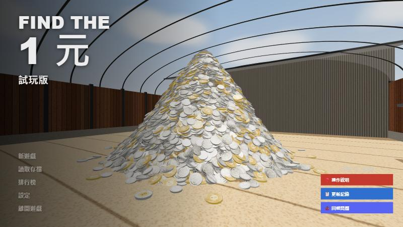
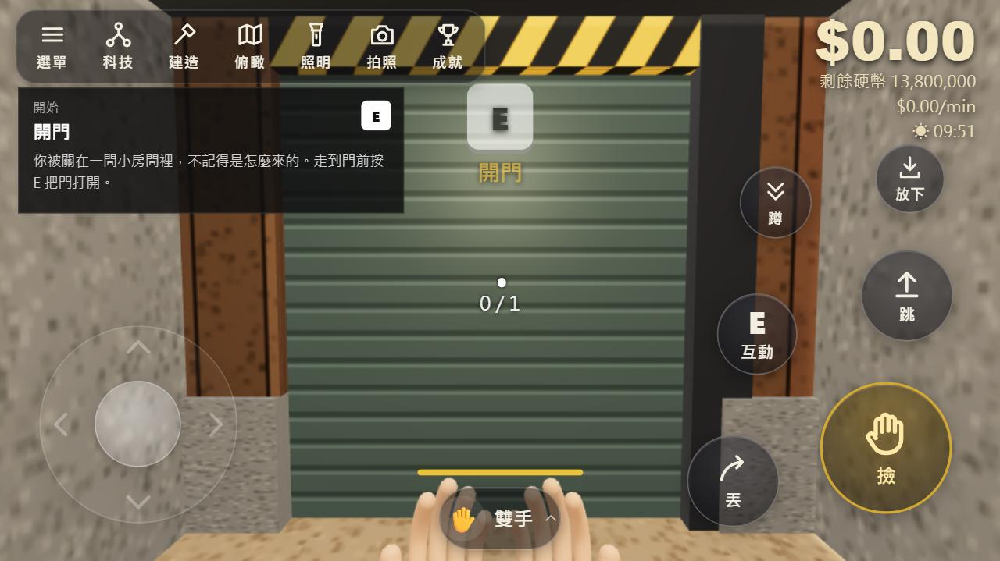

# 大海撈一元 Find The 1元

院子裡倒了一座 1380 萬枚的硬幣山，全是 50 元、10 元和 5 元，裡面藏著幾枚 1 元。
用雙手、鏟子、水桶慢慢挖，把硬幣賣掉換錢，再買工具、蓋機器和輸送帶，把整座山翻過來，找出每一枚 1 元。

**👉 線上直接玩：https://a201009200979603117-create.github.io/find-the-1yuan/**

電腦和手機都能玩，不用安裝。手機請橫著拿，進遊戲會自動全螢幕（Android）。
iPhone 的 Safari 不能讓網頁全螢幕，請按「分享 → 加入主畫面」，從主畫面的圖示打開就是全螢幕。

> **English:** A cozy 3D game about digging through a giant pile of Taiwanese coins to find every NT$1 coin — dig, sell, buy tools, and build conveyor-belt factories. Play in your browser on PC or phone: **https://a201009200979603117-create.github.io/find-the-1yuan/** The game switches to English automatically when your browser isn't set to Chinese (Settings → Language to change).




## 玩法

- 挖硬幣、丟進收購站換錢，看訂單板接訂單
- 五金行買工具：玩具鏟、水桶、圓鍬、草叉、手推車、掃把、金屬探測器、吸塵器、硬幣掃描器
- 科技樹解鎖機器：活塞耙、機械手臂、輸送帶、分流器、壓縮機、包裝機、造粒機、筒倉、發電機……
- 電線桿會自動接到發電機，機器放在黃色範圍內就有電
- 24 種 1 元可以收藏，找到的會放進收藏櫃
- 三種模式：一般、挑戰（計時）、無盡（挖完再倒一車）
- 每日挑戰：每天一座固定的「小」硬幣堆，同一天每個人的都一樣，計時找出所有的 1 元，紀錄和連續天數記在排行榜
- 挑戰朋友：挑戰成功後按「挑戰朋友」產生連結，朋友打開就是同一座硬幣堆，完成時會比較誰快
- 線上排行榜：每日挑戰完成後可以取個暱稱上傳成績，主選單的排行榜看今天的前 20 名（成績存在 Supabase，資料表設定在 `supabase/leaderboard.sql`）
- 成績分享圖：挑戰成功、挖完硬幣堆，或在「成就與統計」按「分享成績」，產生一張有成績的圖片
- 五種硬幣山大小，最大的有 50 公尺高
- 日夜、天氣、拍照模式（有濾鏡，也能調成早上、黃昏、晚上）、俯瞰模式、成就與統計，可以匯出／匯入存檔
- 裝飾：盆栽、小花圃、長椅（可以坐下來休息）、紅燈籠（晚上會亮）、招財貓，不用解鎖
- 輕鬆的小驚喜：玩一陣子會有貓跑進院子，可以摸摸牠；晚上偶爾有流星，白天雨停之後會出現彩虹

## 操作

### 電腦

| 按鍵 | 功能 |
|---|---|
| W A S D | 移動（Shift 跑、C 蹲著走、空白鍵跳） |
| 滑鼠左鍵 | 按住撿硬幣 |
| 滑鼠右鍵 | 丟硬幣（對準收購站進料口就是賣） |
| E | 開門、五金行、訂單板、收藏櫃、機器設定 |
| 1～0 | 換工具（Q 放到地上、F 丟出去） |
| Tab | 科技樹 |
| B | 建造目錄（R 旋轉、X 拆除、PageUp／PageDown 架高） |
| L／P／M | 手電筒／拍照模式／俯瞰模式 |
| O／J | 機器狀態／成就與統計 |
| F5 | 存檔（Esc 暫停） |

按鍵可以在「設定」裡改。也支援手把。

### 手機

- 左下：手指按哪裡，搖桿就出現在哪裡；推到底會跑
- 右半邊畫面：拖曳轉視角
- 右下：撿、丟、跳、互動、蹲、放下；建造時自動換成蓋、旋轉、拆除
- 左上：選單、科技樹、建造、俯瞰、手電筒、拍照、成就；建造時換成架高、降低、方格、復原、藍圖
- 建造時右下有拉近、推遠；看著建築時會出現「複製」
- 下方中間：點一下選工具，也能選快捷欄的建築（建造目錄裡長按建築就能加進快捷欄）
- 教學和提示在手機上會用按鈕的名字說明
- 科技樹、建造目錄、商店、收藏櫃、設定等面板都有手機專用的排法；科技樹多一個「買得起」分類
- 加入主畫面後，沒有網路也能玩（要先連網打開過一次）
- 拍照和匯出存檔會跳出手機的分享選單，可以直接存到相簿、存到檔案或傳 LINE
- 找到 1 元、完成訂單、買到科技、拿到成就時手機會震動（只有 Android，設定裡可以關）
- 網頁版更新了，畫面會跳出「有新版本」，點一下就換成新版
- 設定裡的「省電模式」會把畫面限制在每秒 30 格，玩久了手機比較不會燙
- 字太小的話，設定裡的「字體大小」可以調成大或特大
- 走路畫面晃得會暈的話，設定裡打開「減少晃動」
- 有英文版：瀏覽器不是中文的話會自動用英文，設定裡的「語言 Language」可以切換
- 匯出存檔時按「複製存檔碼」，再到另一邊的「匯入存檔」貼上，就能把存檔搬到別台裝置，或在 iPhone 的 Safari 和主畫面 App 之間搬

## 在自己電腦上跑

下載 `find-the-1yuan.html`，用 Chrome 或 Edge 打開就能玩（要連網路載入 three.js）。
存檔存在瀏覽器裡，換瀏覽器或電腦的話，用遊戲裡的「匯出存檔」存成檔案或複製存檔碼，再到另一邊的「匯入存檔」帶進來。

電腦版的設定裡有「極高畫質」：用螢幕原本的解析度，硬幣之間和機器腳邊會多一層環境光遮蔽的暗影，比較吃顯示卡。

## 遇到問題

遊戲出錯時畫面上會跳出「點這裡回報」，主選單右下也有「🐞 回報問題」。按「複製問題資訊」會複製版本、裝置和錯誤內容，可以貼到這個儲存庫的 [Issues](https://github.com/a201009200979603117-create/find-the-1yuan/issues)。

## 改程式

`find-the-1yuan.html` 是組出來的檔案，原始碼在 `src/`：

- `src/style.css`：畫面樣式
- `src/page-head.html`、`src/page-body.html`、`src/page-end.html`：網頁的骨架和介面
- `src/js/00-boot.js`～`33-main-loop.js`：遊戲程式，照功能分段（設定、場景、硬幣山、玩家、機器、建造、面板、存檔、手機操作、主迴圈……），檔名前面的數字是接起來的順序
- `src/lang/en.tsv`：英文版字典，每行「中文<TAB>英文」。遊戲程式裡還是寫中文，顯示到畫面上的時候才查這個字典換成英文（`src/js/00c-i18n.js`）。新增中文字之後，`python build.py --missing` 會列出還沒翻的

改完 `src/` 之後執行：

```
python build.py
```

就會重新產生 `find-the-1yuan.html`。`python build.py --check` 可以檢查它是不是最新的。

## 技術

- 整個遊戲只有一個 HTML 檔，用 [three.js](https://threejs.org/) r128
- 硬幣以外的模型、材質、音效、音樂都是程式即時產生的
- 網址後面加 `?selftest` 會自動跑一遍主要功能（開新局、存讀檔、面板、分享圖、每日挑戰……），跑完會把存檔還原

## 聲明

這是個人製作的同人作品，玩法靈感來自《Find The Needle》，和原作開發者沒有任何關係。
