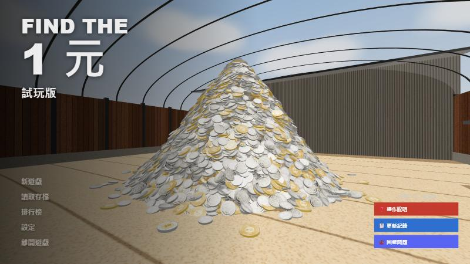
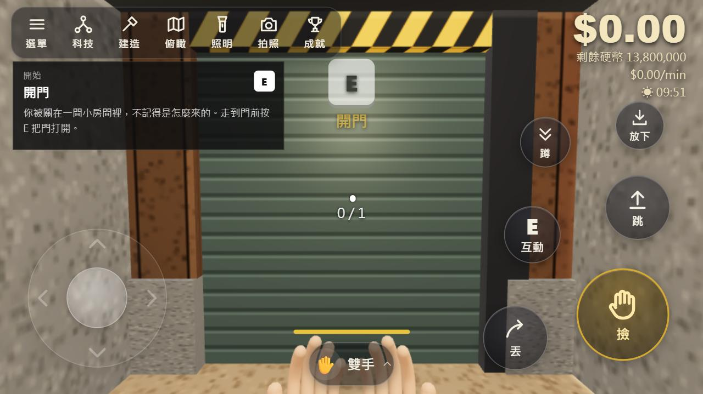

# 大海撈一元 Find The 1元

院子裡倒了一座 1380 萬枚的硬幣山，全是 50 元、10 元和 5 元，裡面藏著幾枚 1 元。
用雙手、鏟子、水桶慢慢挖，把硬幣賣掉換錢，再買工具、蓋機器和輸送帶，把整座山翻過來，找出每一枚 1 元。

**👉 線上直接玩：https://a201009200979603117-create.github.io/find-the-1yuan/**

電腦和手機都能玩，不用安裝。手機請橫著拿，進遊戲會自動全螢幕（Android）。
iPhone 的 Safari 不能讓網頁全螢幕，請按「分享 → 加入主畫面」，從主畫面的圖示打開就是全螢幕。

## 玩法

- 挖硬幣、丟進收購站換錢，看訂單板接訂單
- 五金行買工具：玩具鏟、水桶、圓鍬、草叉、手推車、掃把、金屬探測器、吸塵器、硬幣掃描器
- 科技樹解鎖機器：活塞耙、機械手臂、輸送帶、分流器、壓縮機、包裝機、造粒機、筒倉、發電機……
- 電線桿會自動接到發電機，機器放在黃色範圍內就有電
- 24 種 1 元可以收藏，找到的會放進收藏櫃
- 三種模式：一般、挑戰（計時）、無盡（挖完再倒一車）
- 五種硬幣山大小，最大的有 50 公尺高
- 日夜、天氣、拍照模式、俯瞰模式、成就與統計，可以匯出／匯入存檔

## 操作

### 電腦

| 按鍵 | 功能 |
|---|---|
| W A S D | 移動（Shift 跑、C 蹲著走、空白鍵跳） |
| 滑鼠左鍵 | 按住撿硬幣 |
| 滑鼠右鍵 | 丟硬幣（對準收購站進料口就是賣） |
| E | 開門、五金行、訂單板、收藏櫃、機器設定 |
| 1～0 | 換工具（Q 放到地上、F 丟出去） |
| Tab | 科技樹 |
| B | 建造目錄（R 旋轉、X 拆除、PageUp／PageDown 架高） |
| L／P／M | 手電筒／拍照模式／俯瞰模式 |
| O／J | 機器狀態／成就與統計 |
| F5 | 存檔（Esc 暫停） |

按鍵可以在「設定」裡改。也支援手把。

### 手機

- 左下：手指按哪裡，搖桿就出現在哪裡；推到底會跑
- 右半邊畫面：拖曳轉視角
- 右下：撿、丟、跳、互動、蹲、放下；建造時自動換成蓋、旋轉、拆除
- 左上：選單、科技樹、建造、俯瞰、手電筒、拍照、成就
- 下方中間：點一下選工具

## 在自己電腦上跑

下載 `find-the-1yuan.html`，用 Chrome 或 Edge 打開就能玩（要連網路載入 three.js）。
存檔存在瀏覽器裡，換瀏覽器或電腦的話，用遊戲裡的「匯出存檔」帶過去。

## 技術

- 整個遊戲只有一個 HTML 檔，用 [three.js](https://threejs.org/) r128
- 硬幣以外的模型、材質、音效、音樂都是程式即時產生的

## 聲明

這是個人製作的同人作品，玩法靈感來自《Find The Needle》，和原作開發者沒有任何關係。
